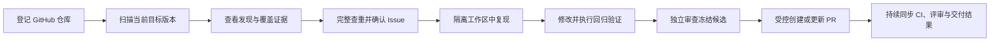
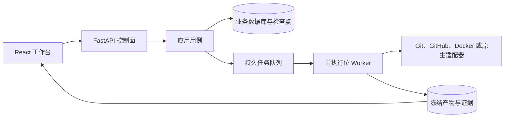

# RepoWatch

RepoWatch 是面向本地开发场景的 GitHub Issue Agent Harness。它把仓库扫描、问题发现、Issue 分诊、修复验证、独立审查和 PR 跟进组织成一条可追溯的工作流，并通过本地控制台集中展示进度、证据和需要人工处理的事项。

当前版本为 `0.1.0.dev0` 开发预览。核心实现与受控技术验收已完成，最终用户签收和正式发布仍在另行推进。实际验证范围见[当前状态](docs/context/NOW.md)。

## 为什么需要 RepoWatch

在真实仓库中修复问题通常需要串联多种事实。

- 当前代码版本是否完成了有效扫描。
- 扫描发现是否覆盖了足够的模块和依赖。
- GitHub 上是否已经存在相同 Issue 或相关 PR。
- 修复是否真的让目标问题从失败变为通过。
- 独立审查是否基于同一个冻结版本完成。
- PR 的 CI、评审、合并和关闭状态是否与本地验证一致。

RepoWatch 将这些事实保存为持久记录，并在工作台中按仓库展示完整链路。任务执行、人工判断、预算调整和恢复操作都受明确门禁控制。

## 核心流程



工作台默认按仓库展示进度。进入仓库后，可从「概览、分析、问题与修复、配置」查看对应阶段，并沿扫描发现直接进入 Issue、修复证据和 PR。

## 主要能力

### 仓库工作台

- 按仓库汇总分析进度、待处理事项和修复交付。
- 区分当前目标版本与最近一次已核验的历史扫描。
- 展示扫描覆盖、缺口、基线、依赖和候选发现。
- 从扫描发现回看代码位置、证据和关联 Issue。
- 从本机工作台移除仓库。移除会隐藏入口并停止后续本地任务，历史任务和审计证据继续保留。

### 仓库扫描与版本治理

- 对目标分支执行完整扫描，保存代码版本、扫描策略和环境摘要。
- 目标分支变化时撤销旧版本的扫描就绪状态，并按影响范围安排补扫。
- 记录已覆盖模块、验证检查和排除项，避免用历史扫描结果代表当前版本。
- 依赖、镜像、LFS 或子模块内容无法取得时明确记录缺口。

### Issue 分诊与查重

- 在创建新 Issue 前查询已有 Issue 和相关 PR。
- 明确区分同一问题、无关问题和尚无法确认的相似问题。
- 展示系统判断依据，关系不明确时请求人工核对。
- 支持手动、标签和全部合格 Bug 三种准入模式。
- 多目标 Issue 可收敛为一个目标，或拆成独立目标后分别查重和交付。

### 修复、验证与独立审查

- 在受控工作区中完成修改，不把模型生成的改动直接写入宿主任意目录。
- Bug 修复记录修改前失败和修改后通过。
- 功能与重构任务要求明确的验收目标和方案。
- 验证证据绑定实际冻结提交、代码树、配置和输入修订。
- 独立审查使用独立会话和只读权限，不能由实现角色自行跳过。

### 受控发布与 PR 跟进

- GitHub 写入前核对扫描就绪、冻结候选、独立审查、发布意图和 Issue 关系。
- 已有相关开放 PR 时保留外部来源，不重复创建同一修复。
- 每个受管 PR 绑定一个 Issue，返修继续更新原 PR。
- PR 的 CI、评审、合并和关闭状态与本地修复验证分开保存。
- 系统不会自动合并或关闭 PR，最终交付动作由用户或仓库规则完成。

### 预算、恢复与人工处理

- 每个任务有持久预算归属，记录有效执行时长、模型调用、Token 与修复轮数。
- 扫描、修复和返修共用原任务预算，创建新运行不会重置累计用量。
- 程序根据实际产物检测连续无进展和状态振荡，并保留完整尝试历史。
- 全局任务队列首次初始化后保持暂停，配置完成后由用户明确恢复。
- 阻塞卡片展示中文原因、失败步骤和可执行建议。
- 用户按建议处理后点击「已解决，重新检查」，系统重新核验环境、旧执行、远端操作和预算后恢复符合条件的任务。

### 仓库记忆

- 从已验证修复中提炼仓库范围和共享范围的经验。
- 区分代码验证、维护者接受和 PR 合并状态。
- 检索索引可重建，索引丢失时仍可回源业务记录。
- 支持人工纠正、禁用、删除、共享和反馈复核。

## 安全与控制边界

- API 只监听回环地址，控制台通过一次性引导建立本地会话。
- 修改请求校验 Origin、Host、会话 Cookie 和 CSRF Token。
- GitHub PAT 保存在 Windows 凭据库，不写入业务数据库、备份或前端状态。
- GitHub 写入使用独立发布意图和远端回执核对，结果未知时先查询，不盲目重发。
- 默认 Docker 执行环境使用受控卷、无网络和工作区权限隔离。
- 原生执行需要专用普通账户、受限宿主目录和显式绑定，配置开关本身不构成准入证明。
- 预算、旧命令、检查点、产物和远端副作用未核实时，系统保持暂停并保留阻塞。
- 打开或刷新页面不会领取任务、执行仓库命令或调用模型。

## 环境要求

RepoWatch 的受管本地运行面向 Windows。

- Python `3.12`
- [uv](https://docs.astral.sh/uv/)
- Docker Desktop，默认使用 Linux 容器
- Node.js `>=22.12.0`，从源码构建前端时使用
- pnpm `9.12.0`，从源码构建前端时使用

业务数据库、检查点、Git 对象、工作区记录和凭据都位于 Windows 侧。数据目录不能放在网络共享位置。

## 快速开始

以下命令从项目根目录运行。首次安装应选择一个尚不存在的安装目录和独立数据目录。

### 制作并安装发行包

```powershell
pwsh -File scripts/package.ps1
pwsh -File .cache/release/install.ps1 -InstallDirectory C:\RepoWatch
```

离线安装时可指定已准备的缓存目录。

```powershell
pwsh -File .cache/release/install.ps1 `
  -InstallDirectory C:\RepoWatch `
  -Offline `
  -CacheDirectory .cache\uv
```

### 初始化并启动

```powershell
$pythonExecutable = "C:\RepoWatch\Scripts\python.exe"
$dataDirectory = "C:\RepoWatchData"

& $pythonExecutable -m repowatch.operations initialize --data-dir $dataDirectory
& $pythonExecutable -m repowatch.operations start --data-dir $dataDirectory
& $pythonExecutable -m repowatch.operations status --data-dir $dataDirectory
& $pythonExecutable -m repowatch.operations open --data-dir $dataDirectory
```

默认地址为 `http://127.0.0.1:8765/`，可通过 `--port` 修改。关闭浏览器不会停止后台服务。

首次启动后建议按以下顺序配置。

1. 在「设置与维护 → GitHub 账号」绑定 GitHub 账号。
2. 在「设置与维护 → 供应商」和「角色模型」配置模型角色。
3. 在「仓库」登记目标仓库并确认目标分支、执行账号和扫描策略。
4. 查看新扫描任务的预算与准入设置。
5. 确认配置后，明确恢复全局任务队列。

### 停止与备份

```powershell
& $pythonExecutable -m repowatch.operations stop --data-dir $dataDirectory
& $pythonExecutable -m repowatch.operations backup `
  --data-dir $dataDirectory `
  --operation-id <本次备份的唯一标识>
```

`status` 返回 `stopped` 且 `clean_stop=true`，才表示服务已经确认正常退出。升级和恢复前应停止所有写者并建立一致备份。

## 从源码开发

安装锁定的开发依赖。

```powershell
uv sync --project backend --locked --python 3.12
pnpm --dir frontend install --frozen-lockfile --registry=https://registry.npmjs.org
pnpm --dir frontend build
```

初始化开发数据目录并显式迁移。

```powershell
$env:REPOWATCH_DATA_DIR = "C:\RepoWatchData"
backend\.venv\Scripts\python.exe -m repowatch.operations.migrate
```

API 与 Worker 需要分别启动。API 同源提供已构建的前端。

```powershell
backend\.venv\Scripts\python.exe -m repowatch.api --port 8765
```

```powershell
backend\.venv\Scripts\python.exe -m repowatch.worker
```

`repowatch.worker --once` 只执行一次调度。关闭浏览器不会停止 Worker。

## 验证

后端静态检查与测试。

```powershell
backend\.venv\Scripts\ruff.exe check backend\src backend\tests backend\migrations experiments\run.py
backend\.venv\Scripts\ruff.exe format --check backend\src backend\tests backend\migrations experiments\run.py
backend\.venv\Scripts\python.exe -m pytest backend\tests
```

前端构建与 OpenSpec 校验。

```powershell
pnpm --dir frontend build
openspec validate repository-workbench --strict
```

浏览器验收脚本使用本地临时数据和无头 Edge。

```powershell
node experiments\p1-browser.mjs
node experiments\p2-browser.mjs
node experiments\p3-browser.mjs
node experiments\p4-browser.mjs
node experiments\p5-browser.mjs
node experiments\p6-browser.mjs
```

测试与浏览器夹具会使用模拟远端或临时数据库。具体报告、真实 GitHub 边界和未验收项以[当前状态](docs/context/NOW.md)为准。

## 项目结构

仓库按控制面、应用用例、领域模型、宿主适配器、Agent 运行、前端界面和验收入口分层。业务逻辑不直接依赖 SQLite、Docker 或具体 SDK，外部能力通过适配器接入。

```text
repowatch/
├── backend/
│   ├── migrations/versions/     业务库与检查点迁移
│   ├── src/repowatch/
│   │   ├── api/                 FastAPI 路由、会话、同源界面与只读同步
│   │   ├── application/         扫描、分诊、修复、发布、预算、恢复与阻塞用例
│   │   ├── domain/              任务、仓库、预算、扫描和 PR 等领域模型
│   │   ├── adapters/            SQLite、Docker、原生宿主、Git、GitHub、模型与凭据
│   │   ├── runtime/             LangGraph 运行引擎、阶段核验和检查点交接
│   │   ├── worker/              串行调度、扫描、分诊、修复、独审和记忆执行
│   │   ├── operations/          安装、迁移、启停、备份、恢复、清理和诊断
│   │   ├── configuration.py     数据目录及运行配置
│   │   └── security.py          密钥、敏感字段和日志脱敏
│   └── tests/                   单元、集成、迁移、故障恢复和浏览器夹具后端
├── frontend/
│   └── src/
│       ├── App.tsx              全局导航、任务详情和人工控制
│       ├── RepositoryWorkbench.tsx  仓库进度、分析与配置入口
│       ├── Scans.tsx            扫描覆盖、候选发现与 Issue 追踪
│       ├── TaskEvidence.tsx     查重比较、范围决定和修复证据
│       ├── PullRequestLifecycle.tsx 受管 PR、CI 与评审状态
│       ├── Memory.tsx           仓库记忆与全局索引管理
│       ├── Repositories.tsx     仓库登记、账号和执行策略
│       ├── ModelConfiguration.tsx   供应商和角色模型配置
│       └── workbench.css        工作台布局、表格和响应式样式
├── experiments/                 扫描、修复、安装和无头浏览器验收入口
├── docs/
│   ├── context/                 当前状态、目录映射、RUNBOOK 与历史入口
│   ├── development/             运行、持久化、扫描、记忆和本地运维说明
│   ├── adr/                     架构决策记录
│   └── research/                外部项目与实现研究
├── openspec/changes/            规格变更、设计、任务和验收场景
├── scripts/                     发行打包与安装脚本
├── AGENTS.md                    项目协作与实现规则
├── PROJECT_INDEX.md             按任务查找权威文档的入口
├── README.md                    项目概览和快速开始
└── GLOSSARY.md                  项目术语表
```

### 关键调用路径



- API 负责配置、人工决定、状态投影和只读同步，不直接执行重任务。
- 持久任务队列保存任务修订、预算归属和执行条件，由 Worker 串行领取。
- Worker 通过受控适配器读取仓库、创建隔离工作区、调用模型并保存验证证据。
- 业务数据库是任务、决定和交付状态的权威来源，前端刷新时重新读取持久状态。
- 模型调用、仓库命令和远端写入不放在数据库长事务内。

### 运行时数据目录

发行版使用独立绝对数据目录，目录中的主要文件如下。

```text
<data-directory>/
├── business.sqlite3       仓库、任务、运行、预算和人工决定
├── checkpoints.sqlite3    LangGraph 运行检查点
├── artifacts/             不可变日志、审查和验证证据
├── git-objects/           宿主受管 Git 对象
├── memory-index.sqlite3   可重建的仓库记忆检索索引
├── workspaces/            工作区元数据
├── backups/               已完成核验的一致备份
└── runtime/               服务状态、短期引导和受管进程日志
```

## 当前状态与限制

- 默认 Docker 执行环境已完成 Python、JavaScript 和 TypeScript 样本的受控验收。
- Windows 原生 CLI 执行链路已有独立受限宿主验收样本。
- 模型调用在最终受控样本中使用确定性夹具，真实付费模型效果仍需单独评估。
- 任意私有依赖、缺失的 LFS 实体和缺失的子模块内容不被推断为已支持。
- 多目标 Issue 的范围处理和本地夹具已接入，每个子目标到独立 PR 的完整真实链路仍需验收。
- 当前是开发预览，最终产品签收、生产泛化结论和发布授权尚未完成。

最新进度和证据见[当前状态](docs/context/NOW.md)，未完成验收项见[仓库工作台任务](openspec/changes/repository-workbench/tasks.md)。

## 文档入口

- [项目索引](PROJECT_INDEX.md)
- [当前状态与接续](docs/context/NOW.md)
- [需求基线](docs/requirements-baseline.md)
- [设计基线](docs/design-baseline.md)
- [实施契约](docs/implementation-contracts.md)
- [本地安装与运维](docs/development/local-operations.md)
- [本地控制与人工处理](docs/development/local-control.md)
- [工作区与扫描](docs/development/workspaces-scans.md)
- [运行引擎与恢复](docs/development/runtime.md)
- [仓库记忆](docs/development/memory.md)
- [架构决策记录](docs/adr/)
- [术语表](GLOSSARY.md)

贡献代码前请先阅读[协作规则](AGENTS.md)和[操作前置条件](docs/context/RUNBOOK.md)。
